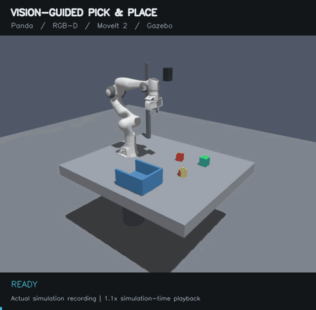

# Vision-Guided Pick-and-Place Robot

A Panda arm finds a red cube with an overhead RGB-D camera, picks it up,
and places it in a bin. Built with ROS 2 Jazzy, MoveIt 2 and Gazebo.
The camera checks the final position before the arm returns home.



A complete cycle recorded in Gazebo, played at 1.1× simulation speed.

## System

```text
Gazebo RGB + depth + CameraInfo
              |
              v
    RGB-D object localizer -- /perception/object_pose --> task state machine
                                                           |          |
                                            MoveIt 2 plans |          | gripper
                                                           v          v
                                              ros2_control controllers
                                                           |
                                                           v
                                                    Gazebo Panda arm
```

OpenCV finds the cube by colour and uses depth to estimate its 3D position.
MoveIt 2 plans the arm motion, and `gz_ros2_control` runs the controllers in
Gazebo. A C++ task node handles each step, recovery and CSV logging.

## Packages

- `pick_place_description`: robot model, workcell and controller settings.
- `pick_place_moveit_config`: MoveIt planning and kinematics settings.
- `pick_place_perception`: cube detection and 3D localisation.
- `pick_place_tasks`: C++ task logic and run logs.
- `pick_place_bringup`: launch files.

## Requirements

- Ubuntu 24.04
- ROS 2 Jazzy Desktop
- Gazebo Harmonic / `ros_gz`
- MoveIt 2
- `ros2_control` and `gz_ros2_control`

Install package dependencies after cloning:

```bash
cd ~/project/manipulation_ws
source /opt/ros/jazzy/setup.bash
sudo rosdep init                    # only if rosdep has never been initialized
rosdep update
rosdep install --from-paths src --ignore-src -r -y --skip-keys ament_python
```

## Build

```bash
cd ~/project/manipulation_ws
source /opt/ros/jazzy/setup.bash
colcon build --symlink-install
source install/setup.bash
```

## Run

Open Gazebo and RViz and run one pick-and-place cycle:

```bash
cd ~/project/manipulation_ws
source /opt/ros/jazzy/setup.bash
source install/setup.bash
ros2 launch pick_place_bringup pick_place.launch.py
```

To start the task manually:

```bash
ros2 launch pick_place_bringup pick_place.launch.py auto_start:=false
```

Then run this in another terminal after sourcing the workspace:

```bash
ros2 service call /pick_place/start std_srvs/srv/Trigger "{}"
```

Add `rviz:=false` to leave RViz closed.

To run headless and choose where to save the results:

```bash
ros2 launch pick_place_bringup pick_place.launch.py rviz:=false \
  'gz_flags:=-s -r -v 3' log_file:=/tmp/pick_place_trial.csv
```

## Logs and status

```bash
# State transitions and details
ros2 topic echo /pick_place/status

# Detected 3D target pose in the world frame
ros2 topic echo /perception/object_pose

# Check controller status
ros2 control list_controllers
```

Successful and failed runs are appended to `logs/pick_place_runs.csv`.

## How it works

1. Find the cube and convert its camera coordinates into the world frame.
2. Add the table, bin and cube to the planning scene for collision checking.
3. Move above the cube, lower the gripper and pick it up.
4. Carry it to the bin, lower it and release it.
5. Check its position in three fresh camera frames, return home and save the result.

The arm follows straight-line paths when lowering and lifting. The placement
pose accounts for where the cube sits in the gripper. Collision checks run
during planning and again after trajectory timing is calculated.

## Test results

The latest test completed **18/20 cycles (90%)**.
Each run started a fresh simulation in the same workcell, using ROS 2 Jazzy
in WSL2.

A completed cycle includes three fresh camera frames confirming the cube is
inside the bin, followed by the arm returning home. The two failures were a
camera-confirmation timeout and a controller/state-readiness timeout.
All 20 runs are included in the result.

The simulation holds the cube with Gazebo's detachable-joint constraint and
repositions it above the bin after release so it can settle before the camera
check. These results cover that assisted setup. Physical grasping and tests
across different scenes remain future work.

[Full test conditions and individual results](docs/validation-2026-10-13/README.md).

## License

Apache-2.0.
